# ha-family-link

[](https://www.home-assistant.io/integrations/marketplace/)
[](https://github.com/juju35/ha-family-link/actions/workflows/hacs.yml)
[](https://github.com/juju35/ha-family-link/actions/workflows/validate.yml)
[](https://github.com/juju35/ha-family-link/actions/workflows/lint.yml)
[](https://github.com/juju35/ha-family-link/releases/latest)
[](https://github.com/juju35/ha-family-link/blob/main/LICENSE)
[](https://buymeacoffee.com/julienstep9)

<p align="center">
  
</p>

<p align="center">
  
</p>

Home Assistant integration for **Google Family Link**: your children's **screen time**, the **apps** they use, their **devices' lock state**, **time bonuses**, **bedtime and school time**, their **location and route** — and the actions to go with them: add or revoke a bonus, lock, unlock, ring, update the location, set an app rule, send an **emergency** alert. With its own **animated Lovelace cards**, full and mini.

[](https://my.home-assistant.io/redirect/marketplace_repository/?owner=juju35&repository=ha-family-link&category=integration)

| Full card | Locked tablet | Mini cards |
|---|---|---|
| 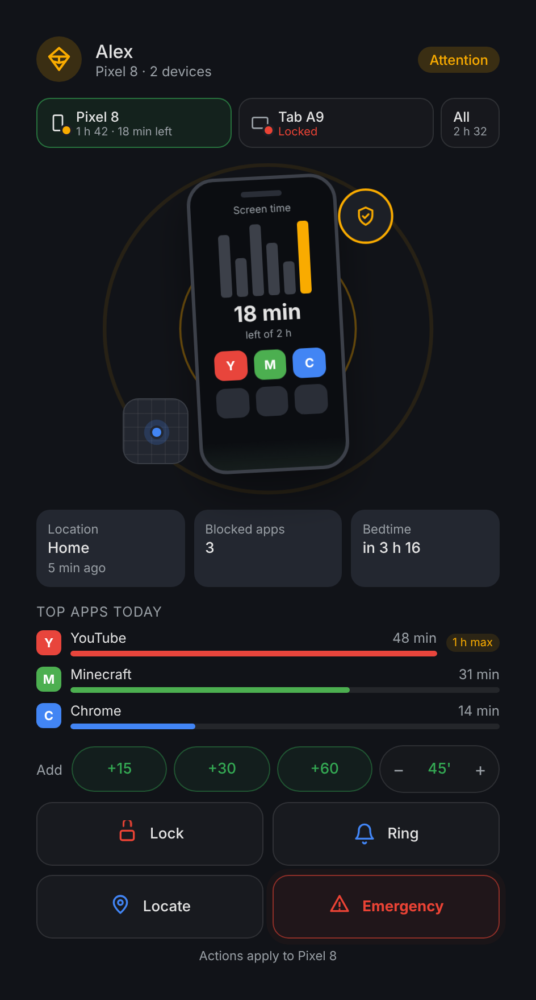 | 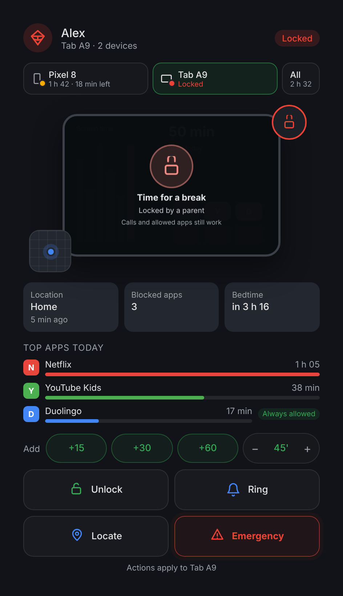 | <br>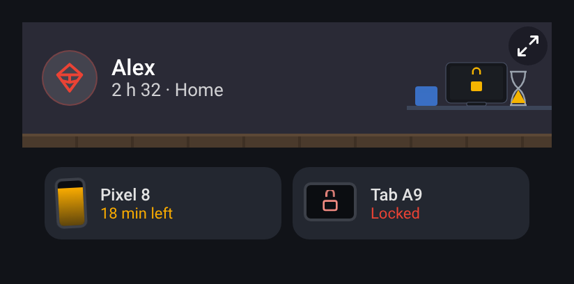<br>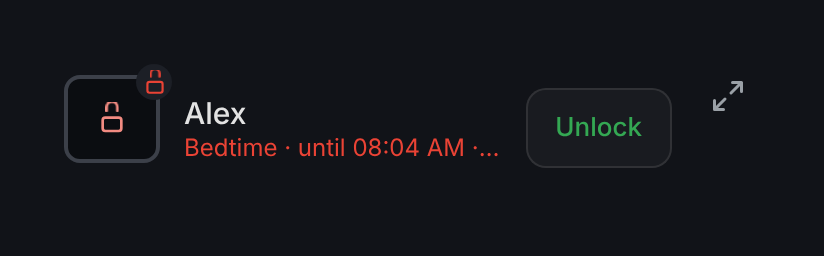 |

> Family Link has no public API. This integration uses your Google session the way the familylink.google.com web app does. It is not affiliated with or endorsed by Google, and Google may change the service at any time.

## Features

- **Set up in the UI**: paste the cookies of familylink.google.com once; the integration keeps the session alive by itself
- **Every supervised child, every device**: one Home Assistant device per child, one per phone or tablet, linked to the child
- **Status** per child — tracked, attention, locked, not tracked — which colors the cards' header icon and drives automations
- **Screen time** today per child and per device, **time left** (daily limit, or the running bonus), **top apps** with their rules (limit, always allowed, blocked)
- **Bedtime and school time** windows, active or coming, as binary sensors with the daily limit reached, and the next restriction as a timestamp
- **Weekly schedule from Home Assistant**: bedtime, school time and daily limit switches; the quota of each weekday; the bedtime and school time hours of each weekday; tonight-only and today-only changes; who can call and text the child
- **School mode**: every app of a child blocked but the essential ones (phone, messages, maps, the Home Assistant app, school apps…) and the ones you always allow, their rules put back afterwards; by hand, by action, or **driven by the Pronote timetable**: on a little before the first lesson of the day, off after the last one (see [School mode](#school-mode))
- **Location** of each child as a `device_tracker` (place, address, accuracy, battery of the device that reported it): Home Assistant records the route the card draws
- **Actions**: add a time bonus, revoke it, lock, unlock, ring, update the location, block / limit / always allow an app, emergency, refresh
- **Emergency**: rings the device (every device of the child when none is given) through Family Link and, through the Home Assistant app on the child's phone, sends a critical notification with your message — even on silent
- **Reliable**:
  - every request is signed again (the Google signature carries a timestamp: a fixed one goes stale and is refused)
  - the short-lived session cookies are rotated by the integration, as a browser does, and saved
  - transient errors (network, timeout, rate limit, server error) are retried with backoff, honoring `Retry-After`; an action is only retried when Google surely did not get it (no connection, rate limit), so a lost answer never gives a bonus twice
  - the Google cookies live in the integration's own HTTP session, never in the one Home Assistant shares with other integrations
  - **cached data on transient API errors**: the last good data stays shown, flagged stale, instead of the entities going unavailable
  - **automatic session refresh**, and a **persistent notification** when Google really needs a new sign-in (with the re-authentication flow), dismissed by the next success
  - each child's sections are fetched in parallel; a failing section keeps its last value without blocking the others
- `custom:family-link-card`, **shipped with the integration** and loaded automatically: an animated phone or tablet showing the week's screen time and the apps, a protection shield, the lock dropping in when the device is locked, device chips for children with several devices, top apps, bonus band with **Revoke**, add-time presets and custom duration, lock / ring / locate / emergency buttons, a **location popup with the route on the map** and a replay slider
- `custom:family-link-mini-card`: the child at a glance (a small device filling up with the time used, or one tile per device), with a button to open the full card
- Diagnostics download without cookies, names, e-mails or positions
- 22 languages for the integration and the cards (see [Translations](#translations))

## Prerequisites

- A Google **parent** account supervising at least one child in Family Link
- A computer with a browser to export the cookies once (Chrome, Edge or Firefox)
- For the emergency message: the Home Assistant app on the child's phone (optional)

## Installation

### Via the Marketplace (recommended)

Click the button below to add the repository directly:

[](https://my.home-assistant.io/redirect/marketplace_repository/?owner=juju35&repository=ha-family-link&category=integration)

Then click **Install** and restart Home Assistant.

Or manually:

1. Open **Settings → Marketplace → Add from link** (top right; this needs a GitHub account connected)
2. Add `https://github.com/juju35/ha-family-link` — Type: **Integration**
3. Open **Family Link** and click **Install**
4. Restart Home Assistant

The cards are **part of the integration**: at startup they are added to the dashboard resources (`/family_link_frontend/family-link-card.js`, module). After an install or an update, restart Home Assistant and refresh the browser (clear the companion app cache if needed). If your dashboards are in YAML mode, the cards are loaded on every page without going through the resources.

### Manual

Copy `custom_components/family_link/` to `/config/custom_components/family_link/`, then restart Home Assistant.

## Configuration

### Integration

**Settings → Devices & services → Add integration → Family Link**, then paste your cookies:

1. On a computer, open a **Firefox private window** and sign in to [familylink.google.com](https://familylink.google.com) with the **parent** account (see [Which browser](#which-browser) below).
2. Export the cookies of the page, either:
   - with a cookie extension such as **Cookie-Editor**: *Export → JSON*;
   - or from the developer tools (F12): **Network** tab, reload, select any request to `kidsmanagement-pa.clients6.google.com`, copy the **`Cookie`** request header.
3. Paste them in the form. JSON exports, Netscape `cookies.txt` files and raw `Cookie` headers are all accepted; only the google.com cookies are kept. They must include `SAPISID` (or `__Secure-3PAPISID`).

One entry per parent account. Every supervised child of the family is added, with their devices; children and devices added later in Family Link appear on their own.

#### Which browser

**Chrome and Edge on Windows** (version 146 and later) bind the Google session to the computer they run on ([Device Bound Session Credentials](https://developer.chrome.com/docs/web-platform/device-bound-session-credentials)): its short-lived cookies can only be renewed by that browser, so cookies exported from it stop working within minutes — Home Assistant then reports *Family Link: sign in again* with `HTTP 401` in the log. Use **Firefox**, in a **private window**:

1. open a private window, sign in to familylink.google.com, export the cookies;
2. close the private window **without signing out** — signing out revokes the cookies, and a window left open would keep renewing the same cookies in parallel with Home Assistant.

The integration then keeps the session alive by itself. When the session is refused and Google also refuses to renew its cookies, the notification and the log say so.

### Options

**Settings → Devices & services → Family Link → Configure**:

| Option | Default | Description |
|---|---|---|
| Update interval | 120 s | Screen time, locks and bonuses |
| Location interval | 300 s | Last known location (the device is not woken up) |
| Keep cached data for | 3600 s | When Family Link can't be reached, the last data stays shown this long before the entities become unavailable |
| Emergency notification service per child | — | One line per child: `Alex: notify.mobile_app_pixel_8` |
| Pronote timetable per child (school mode) | suggested | One line per child: `Alex: sensor.pronote_alex_today_s_timetable` — see [School mode](#school-mode) |
| Apps left reachable by the school mode | — | Package names, one per line, on top of the essential and always allowed apps |

### When Google asks for a new sign-in

Google can end a session (password change, sign-out, security check). When it refuses the session twice in a row — after a cookie rotation each time — the integration shows a **persistent notification** and starts the **re-authentication** flow (Settings → Devices & services shows *Reconfigure*). Paste fresh cookies: no entity, automation or card changes. The cached data stays on the dashboards meanwhile, and the notification goes away with the next successful update.

### Entities

For each **child** (device named after the child):

| Entity | Example | Description |
|---|---|---|
| Location | `device_tracker.alex` | Last known location: latitude, longitude, accuracy, battery, place and address; its history is the route the card draws |
| Status | `sensor.alex_status` | `tracked`, `attention`, `locked` or `not_tracked` — the source of the cards (their data is in its attributes, not recorded) |
| Screen time | `sensor.alex_screen_time` | Minutes today, all devices |
| Battery | `sensor.alex_battery` | Battery of the device that reported the location |
| Update location | `button.alex_update_location` | Asks the device for a fresh location (uses its battery) |
| School mode | `switch.alex_school_mode` | On = every app blocked but the essential ones (see [School mode](#school-mode)). Attributes: source (`manual` or `pronote`), end of the school day, apps blocked |
| Blocked apps | `sensor.alex_blocked_apps` | Number of blocked apps, their titles in the `apps` attribute (diagnostic) |
| Limited apps | `sensor.alex_limited_apps` | Number of apps with a daily limit, their titles in `apps` (diagnostic) |
| Bedtime | `switch.alex_bedtime` | Weekly bedtime switch; turning it on or off also changes tonight, as the Family Link app does. Attribute `today`: bedtime tonight, overrides included |
| School time | `switch.alex_school_time` | Weekly school time switch, today changed too; attribute `today` |
| Daily limit | `switch.alex_daily_limit` | Daily screen time limit on or off (every device) |
| Limit Monday … Sunday | `number.alex_limit_monday` | Weekly quota of each weekday in minutes, every device (configuration) |
| Bedtime / school time start and end, Monday … Sunday | `time.alex_bedtime_start_monday` | Weekly hours of each weekday — 28 entities, **disabled by default**: enable the ones you use (configuration) |
| Calls and texts | `select.alex_calls_and_texts` | Who can call and text the child: `anyone`, `contacts` (only the contacts you add), `contacts_groups` (those and limited groups) |
| Always allowed apps | `sensor.alex_always_allowed_apps` | Number of always allowed apps, their titles in `apps` (diagnostic) |

For each **device** (phone or tablet, linked to the child):

| Entity | Example | Description |
|---|---|---|
| Lock | `switch.pixel_8_lock` | On = locked; turn on to lock, off to unlock |
| Screen time | `sensor.pixel_8_screen_time` | Minutes today on this device |
| Time left | `sensor.pixel_8_time_left` | Minutes left today (daily limit, or the running bonus); unknown without a limit. Attributes: daily limit, bonus, restriction in force, bedtime and school time active |
| Ring | `button.pixel_8_ring` | Rings the device, even on silent |
| Add 15 / 30 / 60 min | `button.pixel_8_add_30_min` | Adds a time bonus (handy for voice assistants and dashboards without the card) |
| Daily limit | `sensor.pixel_8_daily_limit` | Today's quota in minutes; unknown without a daily limit |
| Bonus | `sensor.pixel_8_bonus` | Minutes of the running bonus, 0 without one |
| Next restriction | `sensor.pixel_8_next_restriction` | Start of the next bedtime or school time of the day; its kind in the `kind` attribute |
| Bedtime | `binary_sensor.pixel_8_bedtime` | On while bedtime is going on |
| School time | `binary_sensor.pixel_8_school_time` | On while school time is going on |
| Daily limit reached | `binary_sensor.pixel_8_daily_limit_reached` | On once the daily quota is used up (a bonus doesn't change it) |

The status is **locked** while a device is locked, in bedtime or school time, or out of time; **attention** when 15 minutes or less are left or the location is older than an hour; **not tracked** when the devices have been silent for a day or the session is refused.

### Actions

Every action takes `child` — the child's name, user id, or one of their entities — and, for device actions, `device` (name or id; optional when the child has one device).

```yaml
# 30 minutes more today on the phone
action: family_link.add_bonus
data:
  child: Alex
  device: Pixel 8
  minutes: 30

# Cancel the running bonus
action: family_link.revoke_bonus
data:
  child: Alex
  device: Pixel 8

# Lock / unlock now (calls and always-allowed apps keep working)
action: family_link.lock
data:
  child: Alex
  device: Tab A9

# Ring the device
action: family_link.ring
data:
  child: Alex
  device: Pixel 8

# Fresh location (returns the position)
action: family_link.refresh_location
data:
  child: Alex
response_variable: where

# App rules: limit (minutes per day), block, always_allow, default
action: family_link.set_app
data:
  child: Alex
  app: YouTube            # title of an app of the child, or a package name (com.example.app)
  mode: limit
  minutes: 60

# Emergency: ring + critical notification through the Home Assistant app
action: family_link.emergency
data:
  child: Alex
  device: Pixel 8          # optional: every device of the child rings without it
  message: Call me back right now please.
  ring: true
  refresh_location: true
  # notify_service: notify.mobile_app_pixel_8   # overrides the option

# Weekly schedule: bedtime from 21:30 on Fridays and Saturdays (the end stays)
action: family_link.set_schedule
data:
  child: Alex
  kind: bedtime              # or school_time
  days: [fri, sat]
  start: "21:30"
  # end: "07:30"
  # enable: false            # turns these days off (their hours are kept)

# Tonight / today only: no bedtime tonight, or school time until 18:00 today
action: family_link.schedule_today
data:
  child: Alex
  kind: bedtime
  enable: false
  # start / end: today's hours by default

# Daily limit: 1 h 30 every Wednesday (every device), or today only (no days; devices optional)
action: family_link.set_daily_limit
data:
  child: Alex
  minutes: 90
  days: [wed]
  # devices: [Pixel 8]       # today only, these devices

# School mode on (off with enable: false)
action: family_link.school_mode
data:
  child: Alex
  enable: true

# Fetch now
action: family_link.refresh
```

`child` takes the child's name or user id, one of its entities, or its Home Assistant device id (or the device id of one of its phones, which then also works as `device`).

Each action fires a `family_link_action` event (`action`, `child`, `child_name`, `device`, …) for your automations; the school mode fires `school_mode_on` and `school_mode_off`, with its `source` (`manual` or `pronote`).

### School mode

The school mode blocks every app of the child, in one request, but:

- the essential apps: phone, messages, contacts, clock, calculator, calendar, camera, keyboard, settings, maps, Google Play services, the Home Assistant app (so the emergency message still gets through), Pronote, Google Classroom and Google Docs;
- the apps you list in the **Apps left reachable by the school mode** option (package names, e.g. `com.duolingo`);
- the apps you always allow in Family Link.

The rule each app had before (none, or a daily limit) is saved in Home Assistant and put back when the school mode stops, also after a restart. An app installed while it is on is blocked at the next update.

**With Pronote**: set the "today's timetable" sensor of the [Pronote integration](https://github.com/delphiki/hass-pronote) for the child in the **Pronote timetable per child** option (`Alex: sensor.pronote_alex_today_s_timetable`; the options suggest the sensor of the Pronote student carrying the child's first name). The school mode then turns on 15 minutes before the first lesson of the day and off after the last one; canceled lessons don't count, so a day whose last lessons are canceled ends earlier, and a day without lessons (weekend, holidays, every lesson canceled) leaves it off. Turned off by hand during the school day, it stays off until the end of that day; turned on by hand, Pronote doesn't turn it off.

## Cards

### Card types

| Type | Description |
|---|---|
| `custom:family-link-card` | Full card: animated device, device chips, tiles, top apps, bonus, actions, location and emergency popups |
| `custom:family-link-mini-card` | Compact view; the button at the top right switches to the full card, a click outside goes back |

### Visual editor

Both cards have a visual editor. The mini card's editor shows the options of the full card too, used by its expanded view.

### Minimal

```yaml
type: custom:family-link-card
```

Without `entity`, the card shows the first child found.

### Full options

```yaml
type: custom:family-link-card
entity: sensor.alex_status
title: Alex
device: Pixel 8              # device shown first (name or id)
device_type: auto            # auto, phone or tablet
show_scene: true
show_top_apps: true
show_actions: true
show_location: true
illustration: true           # illustrated header (false: classic header)
illustration_theme: auto     # auto (follows the theme), day or night
trace_hours: 24              # route shown when the location popup opens
bonus_presets: [15, 30, 60]  # YAML only
language: fr
```

### Options reference

| Option | Type | Default | Card | Description |
|---|---|---|---|---|
| `entity` | string | first child | both | The child's status sensor |
| `title` | string | child's name | both | Header title |
| `device` | string | — | both | Device shown first; by default the one needing most attention |
| `device_type` | `auto` / `phone` / `tablet` | `auto` | both | Drawing of the device; `auto` follows the model |
| `show_scene` | boolean | `true` | both | Animated phone or tablet |
| `show_top_apps` | boolean | `true` | both | Most used apps today |
| `show_actions` | boolean | `true` | both | School mode, bonus, lock, ring, locate, emergency |
| `show_location` | boolean | `true` | both | Location tile and popup |
| `illustration` | boolean | `true` | both | Illustrated header (the child's device on a shelf, hourglass of the time left); `false` keeps the classic header |
| `illustration_theme` | `auto` / `day` / `night` | `auto` | both | Day or night picture; `auto` (follows the Home Assistant theme: night with a dark theme, day with a light theme) |
| `trace_hours` | number | `24` | both | Period of the route when the popup opens (Today, 24 h, 7 days can be picked there) |
| `bonus_presets` | list | `[15, 30, 60]` | both | Add-time buttons, in minutes — **YAML only** |
| `language` | string | Home Assistant's | both | Force a language |

"both": also used by the mini card's expanded view.

### Location popup

A click on the location tile (or **Locate**) opens a popup at the top of the card with Home Assistant's own map: the **route** of the period (Today, 24 h, 7 days) drawn from the position history of the child's tracker, the current position with its accuracy, and a **replay slider** to see where the child was at a given time. **Update location** asks the device for a fresh position; **Open history** opens the tracker's standard history.

### Emergency popup

**Emergency** opens a popup with a message field, quick replies, and three choices: ring the device (Family Link, even on silent), send a critical notification with the message (Home Assistant app, when a notify service is set for the child), ask for a fresh location. Family Link itself cannot send a text message to a child: the message goes through the Home Assistant app.

## Screenshots

### Animations

Each animation of the cards, in the dark and light themes.

**Phone**: the week's screen time rises with today's bar in the status color, the apps bob, a scan sweeps the screen, protection waves spread out and the shield pulses while the child is tracked; the location tile pings the last position.

| Dark | Light |
|---|---|
| 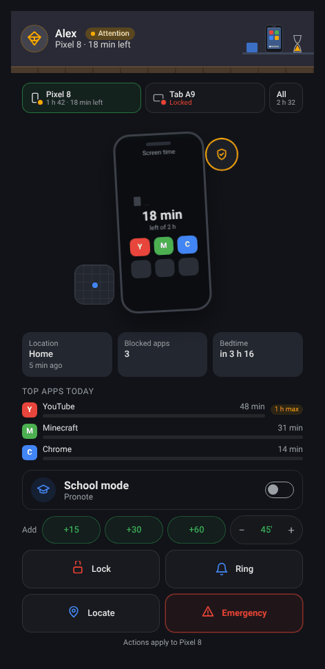 | 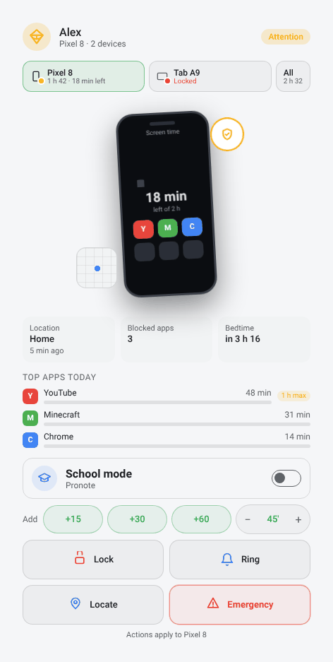 |

**Locked tablet**: the screen dims, the padlock drops in and its shackle snaps shut, with the reason (locked by a parent, bedtime, school time, daily limit).

| Dark | Light |
|---|---|
| 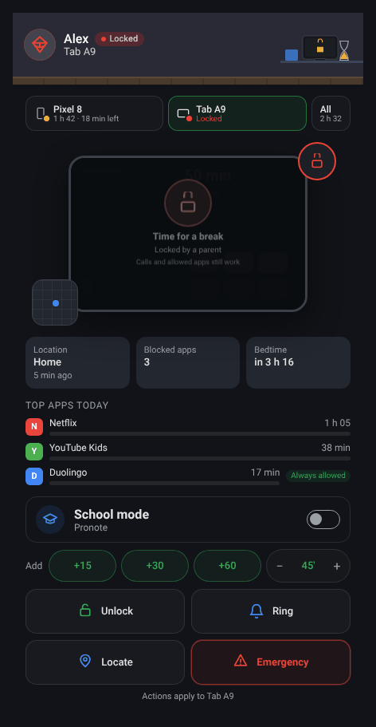 | 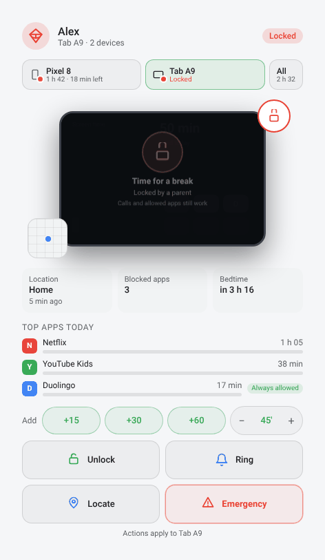 |

**Running bonus**: the band shines, its ring empties as the bonus runs out.

| Dark | Light |
|---|---|
| 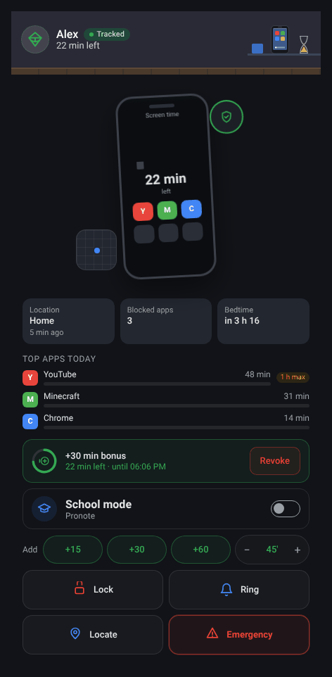 | 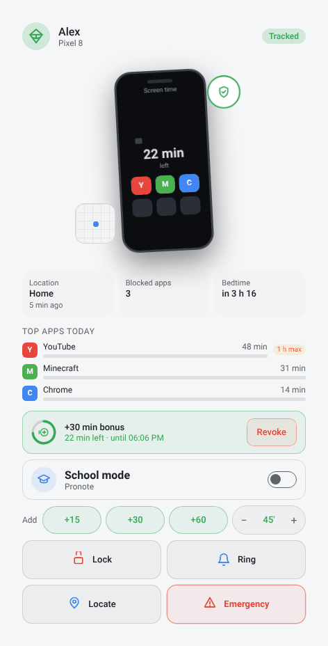 |

**Mini card with two devices**: each device fills up with the time used; a locked one shows its padlock.

| Dark | Light |
|---|---|
| 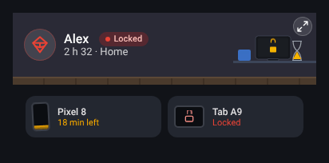 | 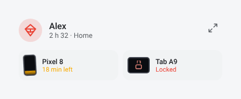 |

### Cards

| | Dark | Light |
|---|---|---|
| Phone |  | 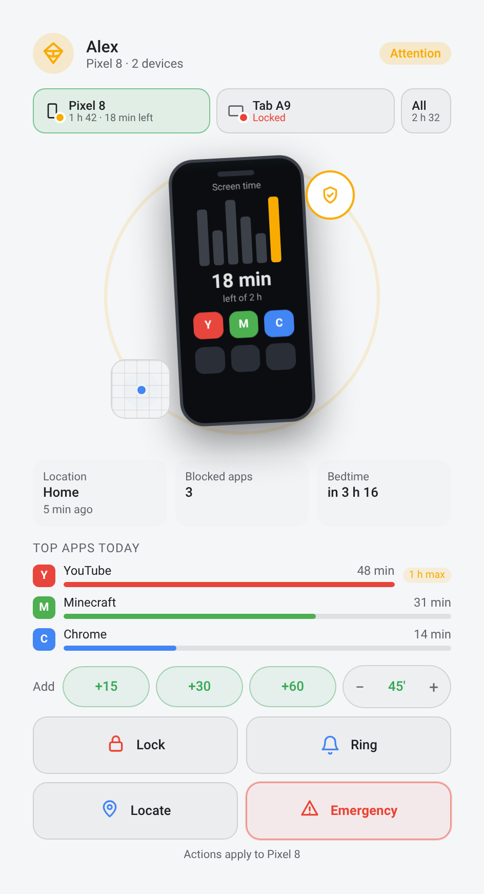 |
| Locked tablet |  | 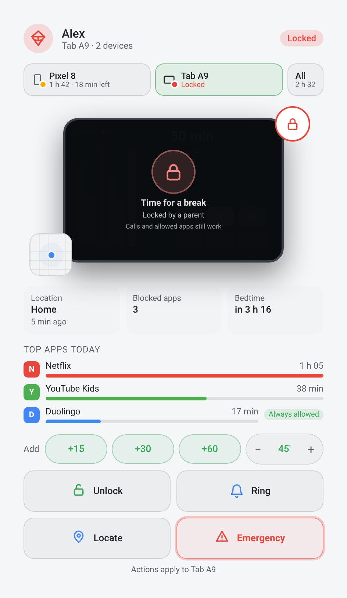 |
| Bonus running | 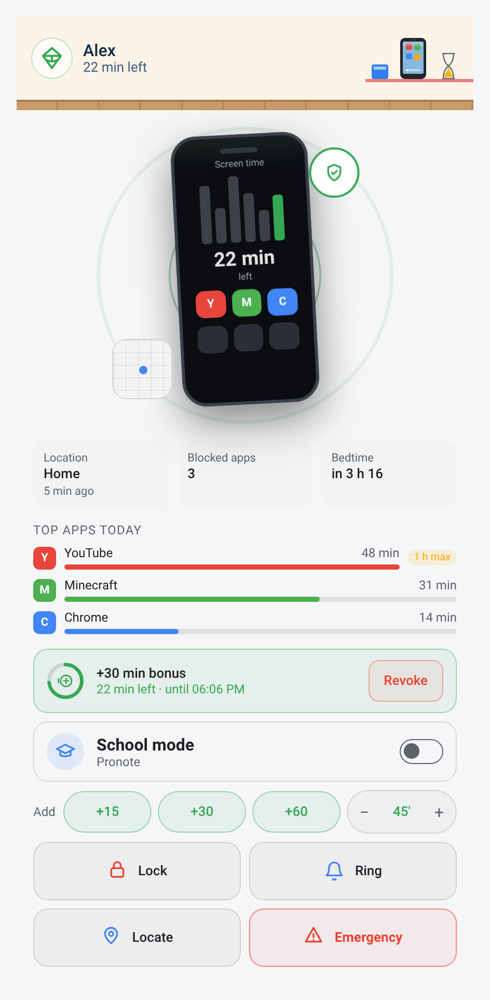 |  |
| Location popup | 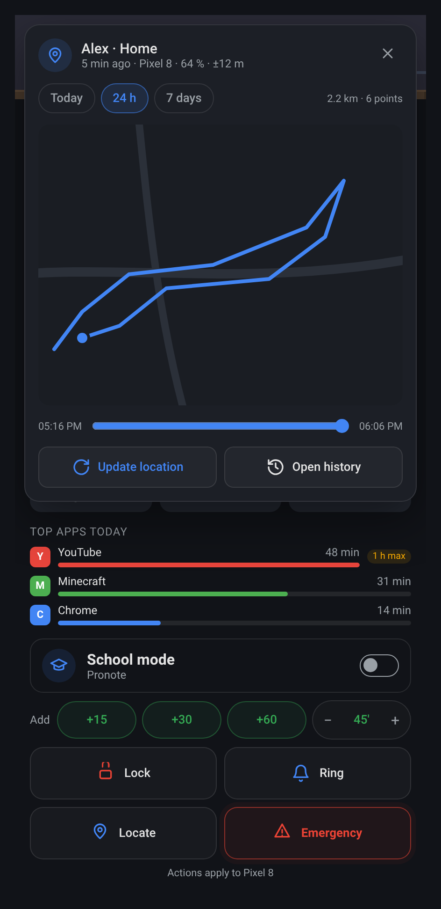 | 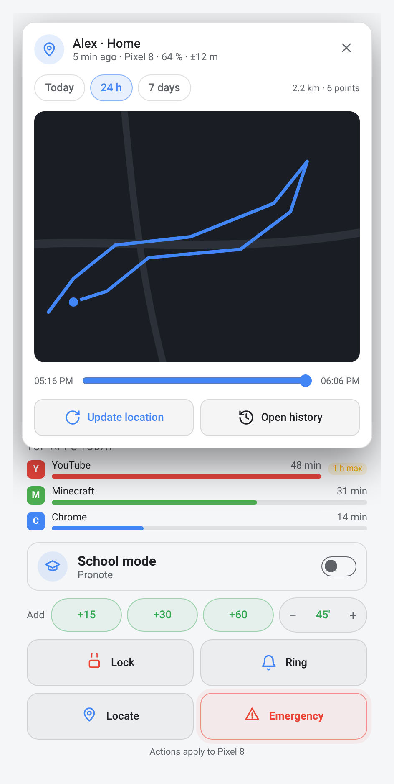 |
| School mode (Pronote) | 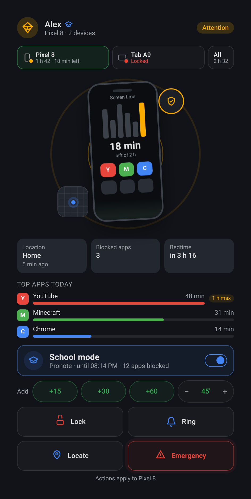 | 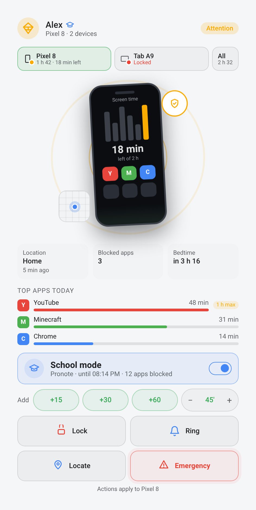 |
| Emergency popup | 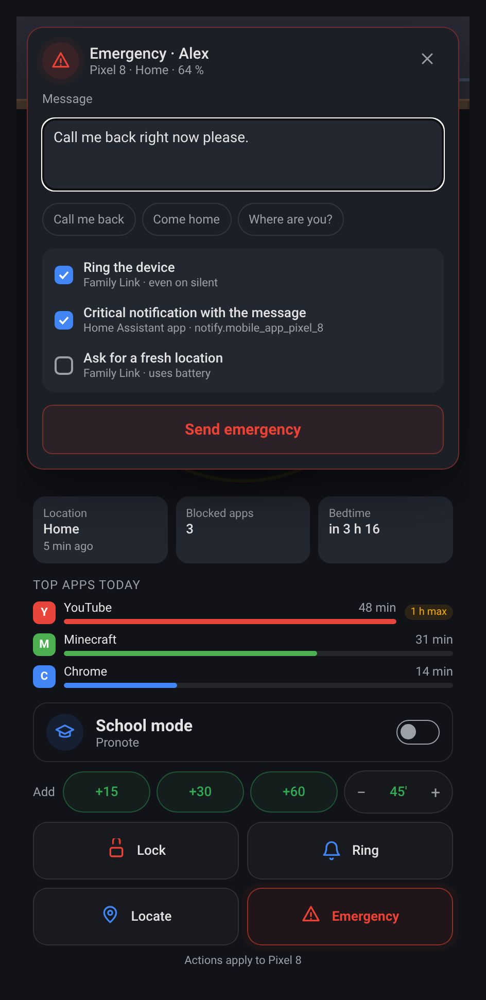 | 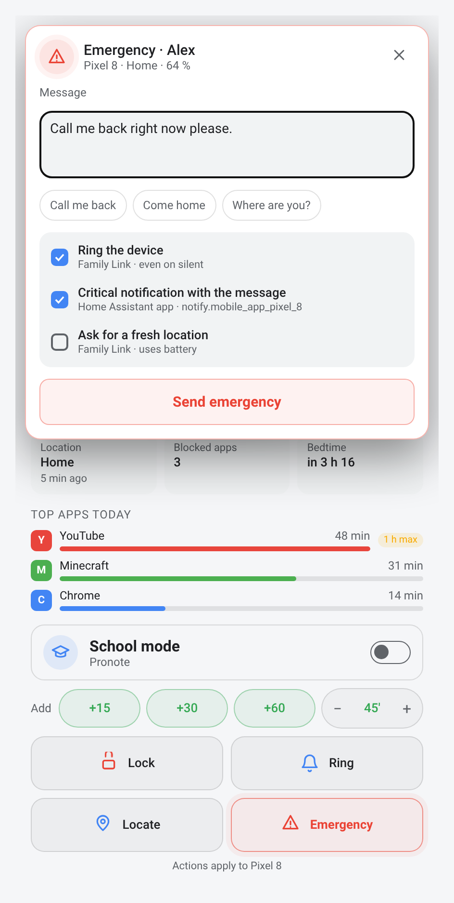 |
| Mini, one device |  | 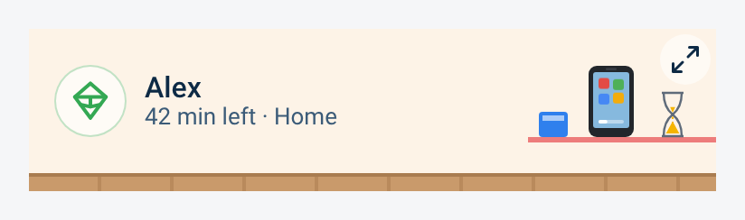 |
| Mini, two devices |  | 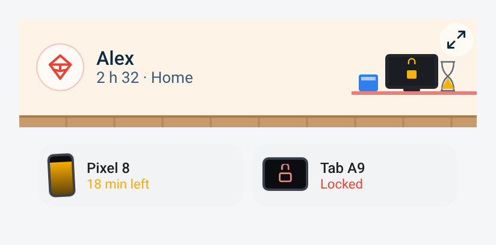 |
| Mini, bedtime |  | 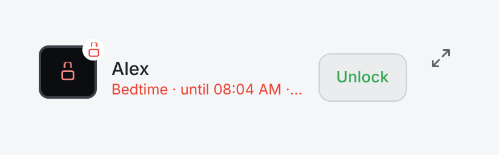 |
| Mini, expanded |  | 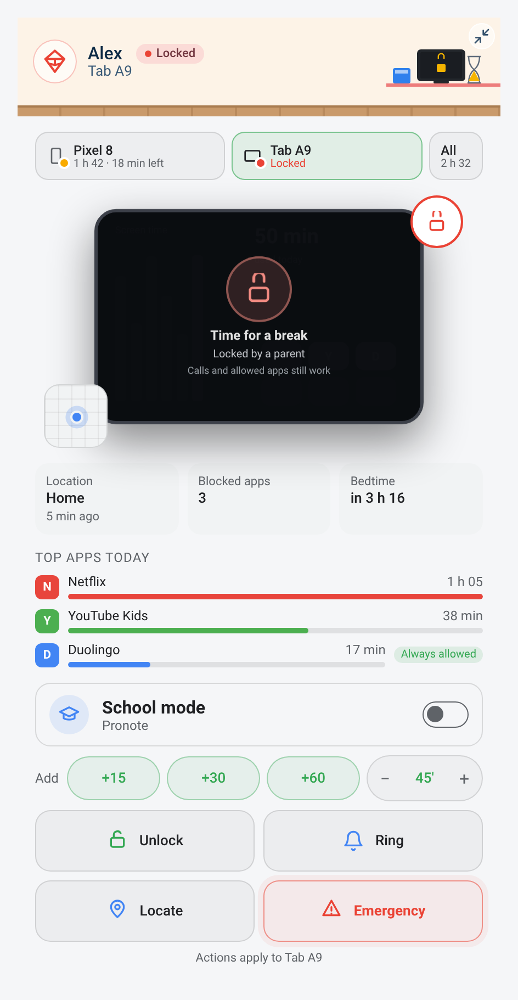 |

## How it works

The integration calls the API the Family Link web app uses (`kidsmanagement-pa.clients6.google.com`), with the parent's Google cookies and a `SAPISIDHASH` authorization computed for every request. One update fetches, for each child and in parallel, the apps and usage, the applied time limits (locks, bonuses, daily limits, bedtime and school time), the weekly schedule (`timeLimit`: switches, hours and quotas of each weekday, today's overrides) and, at their own intervals, who can call and text (every 15 minutes) and the last known location. A schedule that can't be read leaves the screen time data as fresh as it is: only the schedule entities wait. Members (children, names, photos) are read once an hour.

Google rotates the short-lived cookies of a session: the integration takes those it sends back in its answers and asks for fresh ones every six hours (as a browser left open does), and saves them in the config entry.

Locations are last known positions: the device is only asked for a new fix by **Update location** (or the emergency option), which uses its battery.

## Development

The big frontend files are written as ES modules in `src/family-link-card/` (entry `index.js`, translations one file per language in `i18n/`). `scripts/build-frontend.mjs` assembles them into `family-link-card.js` in `custom_components/family_link/frontend/`, which are not committed: build them before running Home Assistant, the tests or the screenshots. The modules share one scope once assembled, so top-level names stay unique; a new module must be listed in its `index.js`.

```bash
npm install && npm run build:frontend  # assembles the frontend files from src/
pip install -r requirements_test.txt && pytest
npm install && npm test          # card tests (node --test)
npm run build                    # assembles the frontend, then checks the translation split the release makes
pip install playwright pillow && playwright install chromium
python scripts/screenshots.py    # renders the stills and every animation GIF into screenshots/
```

Python tests live in `tests/` (pytest, every API answer mocked: no network needed); the card's JavaScript tests live in `test/`.

### Releasing

1. Bump the version in `custom_components/family_link/manifest.json`, `FAMILY_LINK_CARD_VERSION` in `src/family-link-card/card-picker.js` and `package.json`
2. Add a `## <version>` section at the top of [CHANGELOG.md](https://github.com/juju35/ha-family-link/blob/main/CHANGELOG.md)
3. Merge to `main`: the **Release** workflow creates the tag and the GitHub release with the changelog section as notes

## Translations

The integration and the cards follow the language of Home Assistant (the card's `language` option can force another one).

| Language | Code |
|---|---|
| English | `en` |
| Français | `fr` |
| Deutsch | `de` |
| Español | `es` |
| Српски | `sr` |
| Srpski (latinica) | `sr-Latn` |
| Italiano | `it` |
| Nederlands | `nl` |
| Português (Portugal) | `pt` |
| Português (Brasil) | `pt-BR` |
| Polski | `pl` |
| Română | `ro` |
| Dansk | `da` |
| Svenska | `sv` |
| Български | `bg` |
| Русский | `ru` |
| Українська | `uk` |
| Magyar | `hu` |
| Slovenčina | `sk` |
| Čeština | `cs` |
| Slovenščina | `sl` |
| Latviešu | `lv` |
| Ελληνικά | `el` |

The translations other than English and French have not been reviewed by native speakers yet, and `pt-BR` uses the European Portuguese texts for now: corrections and other languages are welcome!

## Credits

This integration was made possible by the work of [Thibault Ducret (tducret)](https://github.com/tducret) on [familylink](https://github.com/tducret/familylink), the Python package that first documented how to talk to Google Family Link: its authentication, its endpoints and the app restriction calls this integration builds on.

## License

MIT — see [LICENSE](https://github.com/juju35/ha-family-link/blob/main/LICENSE).

## Support

If this integration is useful to you, you can [buy me a coffee](https://buymeacoffee.com/julienstep9) ☕
